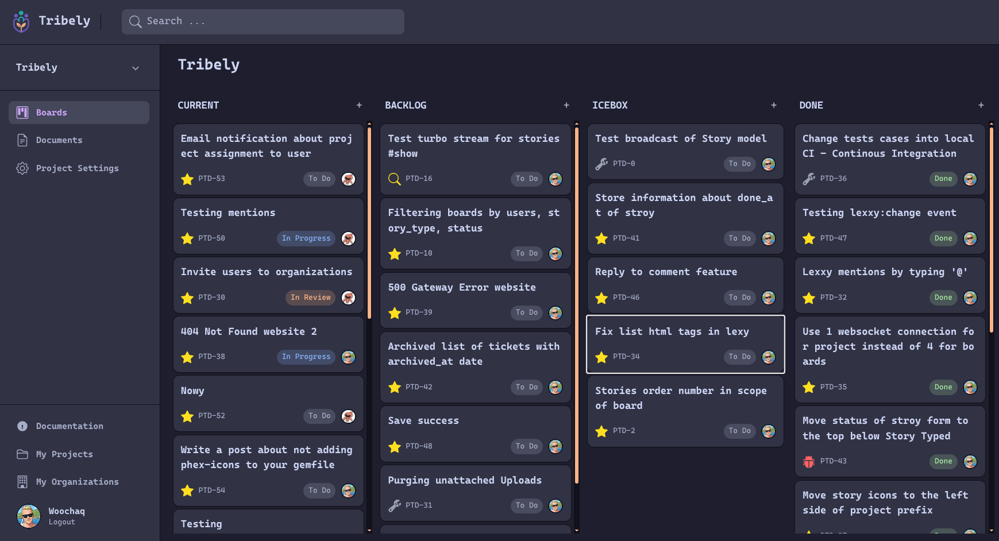

# Tribely

Project management app built with Rails 8.



## Hotwire

The UI is server-rendered HTML ([Phlex](https://www.phlex.fun) components + Tailwind)
made interactive with [Hotwire](https://hotwired.dev) instead of a JavaScript SPA.
JavaScript is loaded with import maps, so there is no Node or bundler step.

- **Turbo Drive** turns links and form submissions into fetch requests and swaps the page body.
  Page refreshes use morphing (`turbo_refreshes_with method: :morph`), so scroll position and
  state are preserved.
- **Turbo Frames** update parts of a page in place, e.g. modals, inline editing of comments and members, search results.
- **Turbo Streams** do targeted updates (append, replace, remove) after form submissions,
  and push real-time changes over Action Cable: when a story or comment is created, updated
  or deleted, everyone viewing the project board sees it without reloading
  (`turbo_stream_from @project`, `broadcast_*_to` in `Story` and `Comment`).
- **Stimulus** controllers in `app/javascript/controllers` add small behaviors: drag and drop
  on boards (`@stimulus-components/sortable`), autosave, story search, modals, the Lexxy rich
  text editor.

Action Cable uses the `async` adapter in development and
[Solid Cable](https://github.com/rails/solid_cable) (database-backed) in production.
In development, [Hotwire Spark](https://github.com/hotwired/spark) reloads the page when
views, CSS or Stimulus controllers change.

## Running locally

Development and test use SQLite, so no database server is needed.

### Requirements

- Ruby 4.0.9 (see `.ruby-version`; `mise install` or `rbenv install` will pick it up)
- [libvips](https://www.libvips.org/install.html) for image variants (avatars)
  - macOS: `brew install vips`
  - Debian/Ubuntu: `sudo apt install libvips`
  - Arch: `sudo pacman -S libvips`

### Setup

```sh
git clone https://github.com/woochaq/tribely.git
cd tribely
bin/setup
```

`bin/setup` installs gems, creates the SQLite database in `storage/` and starts the
app (Rails server + Tailwind watcher) at http://localhost:3000.

Next time, start the app with:

```sh
bin/dev
```

No `config/master.key` is needed locally. Encrypted credentials are only used in production.

### Creating an account

1. Sign up at http://localhost:3000.
2. The app requires email confirmation. In development, emails are not sent but
   caught by [letter_opener_web](https://github.com/fgrosse/letter_opener_web).
   Open http://localhost:3000/letter_opener and click the confirmation link.

Or confirm the user from the Rails console:

```sh
bin/rails console
```

```ruby
User.find_by!(email: "you@example.com").confirm
```

To confirm every pending user at once:

```ruby
User.where(confirmed_at: nil).find_each(&:confirm)
```

### Tests and checks

```sh
bundle exec rspec   # test suite
bin/rubocop         # lint
bin/brakeman        # security scan
```

## Production

Production runs on MySQL and is deployed with [Kamal](https://kamal-deploy.org).
The `mysql2` gem lives in an optional Gemfile group, enabled in the Docker image via
`BUNDLE_WITH=mysql`. To install it locally: `bundle config set --local with mysql`.

### Credentials

Production secrets live in `config/credentials.yml.enc`, encrypted with `config/master.key`
(not in the repository). The committed file belongs to the original deployment and is useless
without its key. To run your own production instance, replace it with your own:

```sh
rm config/credentials.yml.enc
EDITOR="code --wait" bin/rails credentials:edit   # creates a new config/master.key
```

with this structure:

```yaml
secret_key_base: # generated by Rails

production:
  ovh:                 # S3-compatible storage for Active Storage (config/storage.yml)
    access_key_id:
    secret_access_key:
  brevo:               # SMTP for outgoing email (config/environments/production.rb)
    user_name:
    api_key:

honeybadger:
  api_key:             # error tracking, optional

mission_control:       # HTTP basic auth for the jobs dashboard at /jobs
  http_basic_auth_user:
  http_basic_auth_password:
```

Bucket, region and endpoint for storage are set in `config/storage.yml`.

### Deploy

Deploy needs:

- `config/master.key` (or `RAILS_MASTER_KEY`)
- `KAMAL_SERVER_IP` environment variable with the target server address
- secrets listed in `.kamal/secrets`

```sh
KAMAL_SERVER_IP=<server ip> bin/kamal deploy
```
